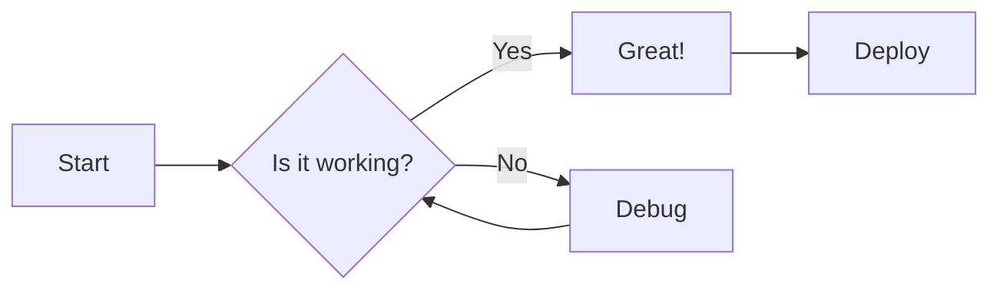
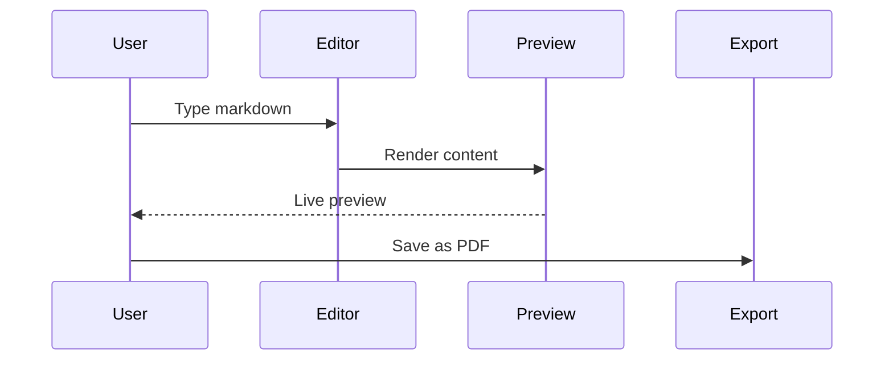

# 🟡 Markdown Cheat Sheet: Syntax, Math & Diagrams

Guide to Markdown, GFM, LaTeX math, Mermaid diagrams, and inline HTML.

## 🟢 Headings

<details>
<summary>Show details</summary>

Use the # symbol to create headings. The number of # symbols determines the heading level.

| Markdown Syntax | Output |
|---|---|
| `# Heading 1` | <h1>Heading 1</h1> |
| `## Heading 2` | <h2>Heading 2</h2> |
| `### Heading 3` | <h3>Heading 3</h3> |
| `#### Heading 4` | <h4>Heading 4</h4> |
| `##### Heading 5` | <h5>Heading 5</h5> |
| `###### Heading 6` | <h6>Heading 6</h6> |

</details>

## 🟢 Text Formatting

<details>
<summary>Show details</summary>

| Formatting    | Markdown Syntax | Output       |
|:-----------   |:---------------:|-------:      |
|Bold           |	`**Hello**`   |**Hello**     |
|Italic	        |  `*Hello*`	  |*Hello*       |
|Bold and italic|	`***Hello***` |	***Hello***  |
|Strikethrough  |	`~~Hello~~`	  | ~~Hello~~    |
|Inline code    |	\`Hello\`	  | `Hello`      |
|Underline      | `<u>Hello</u>`  |	<u>Hello</u> |

</details>

## 🟢 Paragraphs and Line Breaks

<details>
<summary>Show details</summary>

### New paragraph

Leave a blank line between paragraphs.

```Markdown
This is the first paragraph.

This is the second paragraph.
```
#### Output:

This is the first paragraph.

This is the second paragraph.

### Line break

Add `<br>` at the end of a line.

```Markdown
This is the first line.<br>This is the second line.
```
#### Output:

This is the first line.<br>This is the second line.

</details>

## 🟢 Lists

<details>
<summary>Show details</summary>

### Ordered List

Use number followed by period then space.<br> 
Indent nested item with extra space befor the number.

```Markdown
1. First
2. Another item
3. Third 
    1. Indented item
    2. Another indented item
4. Fourth item
```
#### Output:

1. First
2. Another item
3. Third 
    1. Indented item
    2. Another indented item
4. Fourth item

### Unordered List

Use - followed by space.

```Markdown
- Fruits
  - Apple
  - Banana
- Vegetables
  - Carrot
  - Potato
```
#### Output:

- Fruits
  - Apple
  - Banana
- Vegetables
  - Carrot
  - Potato

### Task List

Use - [ ] for an incomplete task and - [x] for a completed task.

```Markdown
- [x] Write the documentation
- [x] Add syntax highlighting
- [ ] Review pull request
- [ ] Deploy to production
```
#### Output:
- [x] Write the documentation
- [x] Add syntax highlighting
- [ ] Review pull request
- [ ] Deploy to production

</details>

## 🟢 Blockquotes

<details>
<summary>Show details</summary>

Use the > symbol to create a blockquote.

```Markdown
> "The best way to predict the future is to invent it." - Alan Kay
```
#### Output:

> "The best way to predict the future is to invent it." - Alan Kay

### Nested blockquotes:

```Markdown
> First level
> > Second level
> > > Third level
```
#### Output:

> First level
> > Second level
> > > Third level

</details>

## 🟢 Tables

<details>
<summary>Show details</summary>

```Markdown
| Name | Age | City |
|------|-----|------|
| John | 25  | Paris |
| Sarah | 30 | London |
| Alex | 28 | Amsterdam |
```
#### Output:

| Name | Age | City |
|------|-----|------|
| John | 25  | Paris |
| Sarah | 30 | London |
| Alex | 28 | Amsterdam |

### Aligning table columns
Use :--- for left alignment.<br>
Use :---: for center alignment.<br>
Use ---: for right alignment.<br>

```Markdown
| Left | Center | Right |
|:-----|:------:|------:|
| A    | B      | C     |
| D    | E      | F     |
```
#### output:
| Left | Center | Right |
|:-----|:------:|------:|
| A    | B      | C     |
| D    | E      | F     |

</details>

## 🟢 Links

<details>
<summary>Show details</summary>

Use square brackets for the link text and parentheses for the URL.
```Markdown
[HAN_University of Applied Sciences](https://www.han.nl/) - click to visit.
```
#### Output:

[HAN_University of Applied Sciences](https://www.han.nl/) - click to visit.

### Reference-style link

Reference-style links are useful when you want to reuse the same URL multiple times.
```Markdown
Visit [HAN][website].

[website]: https://www.han.nl/
```
#### Output:

Visit [HAN][website].

[website]: https://www.han.nl/

</details>

## 🟢 Images

<details>
<summary>Show details</summary>

Use an exclamation mark (!), followed by text in square brackets and the image URL in parentheses.<br>
The image will be shown in he original size.
```Markdown

```
#### output:


### Image sizing

To adjust the size of the image in pixels.
```Markdown

```
#### Output:


</details>

## 🟢 Code

<details>
<summary>Show details</summary>

Markdown supports both inline code and multiline code blocks.

### Inline code

Surround text with backticks `
```Markdown
Use `print()` to display output.
```
#### output:

Use `print()` to display output.

### Fenced code block

Use three backticks \``` before and after the code.<br>
For syntax-highlighted code block, add the programming language immediately after the opening backticks.

#### Example:

\```c<br>
printf("Hello, World!");<br>
\```

#### Output:

```c
printf("Hello, World!");
```

</details>

## 🟢 Horizontal Rules

<details>
<summary>Show details</summary>

Use three or more hyphens - on a separate line.
```Markdown
---
```
#### Output:
---

</details>

## 🟢 Mathematical Expressions

<details>
<summary>Show details</summary>

### Inline Mathematical Expressions
Use a single dollar sign ($) on each side of the expression.
```Markdown
$E = mc^2$ and $\alpha + \beta = \gamma$<br>
The equation is $a^2 + b^2 = c^2$.
```
#### Output:

$E = mc^2$ and $\alpha + \beta = \gamma$<br>
The equation is $a^2 + b^2 = c^2$.

### Display equations:

Use two dollar signs ($$) on separate lines to display an equation in its own block.
```Markdown
$$
\frac{\partial f}{\partial x} = \lim_{h \to 0} \frac{f(x+h) - f(x)}{h}
$$
$$
\sum_{i=1}^{n} i^2 = \frac{n(n+1)(2n+1)}{6}
$$
$$
\int_{-\infty}^{\infty} e^{-x^2} dx = \sqrt{\pi}
$$
```
#### Output:

$$
\frac{\partial f}{\partial x} = \lim_{h \to 0} \frac{f(x+h) - f(x)}{h}
$$
$$
\sum_{i=1}^{n} i^2 = \frac{n(n+1)(2n+1)}{6}
$$
$$
\int_{-\infty}^{\infty} e^{-x^2} dx = \sqrt{\pi}
$$

</details>

## 🟢 Mermaid Diagrams

<details>
<summary>Show details</summary>

### Flowchart

\```mermaid<br>
flowchart LR<br>
    A[Start] --> B{Is it working?}<br>
    B -->|Yes| C[Great!]<br>
    B -->|No| D[Debug]<br>
    C --> E[Deploy]<br>
    D --> B<br>
\```

#### Output:



### Sequence Diagram

\```mermaid<br>
sequenceDiagram<br>
    User->>Editor: Type markdown<br>
    Editor->>Preview: Render content<br>
    Preview-->>User: Live preview<br>
    User->>Export: Save as PDF<br>
\```

#### Output:



</details>

## 🟢 HTML Elements

<details>
<summary>Show details</summary>

### Superscript 

```markdown
x<sup>2</sup> + y<sup>2</sup> = z<sup>2</sup>
```
#### Output:

x<sup>2</sup> + y<sup>2</sup> = z<sup>2</sup>

### Subscript 

```markdown
H<sub>2</sub>O, CO<sub>2</sub>
```
#### Output:

H<sub>2</sub>O, CO<sub>2</sub>

### Keyboard keys

```markdown
Press <kbd>Ctrl</kbd> + <kbd>S</kbd> to save
```
#### Output:

Press <kbd>Ctrl</kbd> + <kbd>S</kbd> to save

### Abbreviation with tooltip

```markdown
<abbr title="Hypertext Markup Language">HTML</abbr> 
```
#### Output:

<abbr title="Hypertext Markup Language">HTML</abbr> 

### Highlighted text

```markdown
<mark>Highlighted text</mark> 
```
#### Output:

<mark>Highlighted text</mark> 

### Colored text

```markdown
<span style="color:red;">Red text</span>
```
#### Output:

<span style="color:red;">Red text</span>

</details>

## 🟢 Accordion

<details>
<summary>Show details</summary>

An accordion is a label you click to reveal hidden content, use `<details>` and `<summery>` .<br>
The `<summary>` is the visible label and everything after it stays folded until clicked. Leave a blank line after the `<summery>`.
```markdown
<details>
<summary>Show details</summary>

This is the hidden text that will appear when you click the summary.

</details>
```
#### Output:

<details>
<summary>Show details</summary>

This is the hidden text that will appear when you click the summary.

</details>

</details>

## 🟢 Comments

<details>
<summary>Show details</summary>

To leave a note in the source that stays out of the page, use `<!--  -->`.
```markdown
Visible text.
<!-- a note to yourself -->
More visible text.
```
#### Output:

Visible text.
<!-- a note to yourself -->
More visible text.

</details>

## 🟢 Escaping Characters

<details>
<summary>Show details</summary>

Use backslash \ to display literal characters:
```markdown
\*Not italic\* and \*\*not bold\*\*

\# Not a heading

\- Not a list item
```

#### Output:

\*Not italic\* and \*\*not bold\*\*

\# Not a heading

\- Not a list item

</details>

## 🟢 Unicode shapes

<details>
<summary>Show details</summary>

You can copy and paste shapes directly into your Markdown file.

**Geometric shapes**

■ □ ● ○ ▲ △ ◆ ◇ ★ ♥

**Colored circles**

🔴 🟢 🔵 🟡 🟣 🟠

**Arrows**

→ ← ↑ ↓ ↔ ⇒ ➜ ⇓

</details>